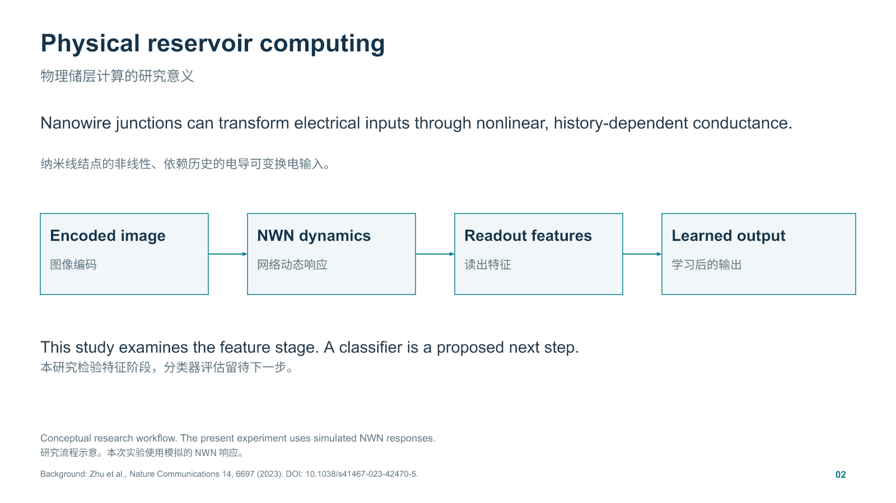
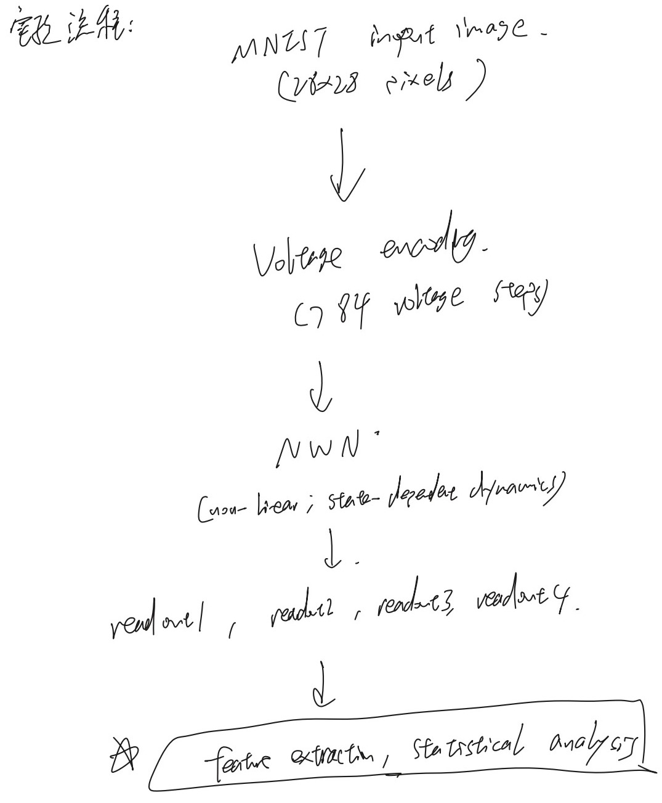

# Neuromorphic Nanowire Networks

University of Sydney SSP (Special Study Program)

This simulation study asks whether a nanowire network can transform MNIST handwritten digits into readout features that separate digit classes. It examines the feature stage of physical reservoir computing, where the network's dynamics transform an input before a separate readout model can be trained.

## Code and reproducible walkthrough

| Material | What it covers |
| --- | --- |
| [Notebook excerpts and screenshot index](docs/notebook-code.md) | Source excerpts from the pilot and expanded notebooks, separately labelled teaching examples, and a guide to all 33 supplied screenshots |
| [Analysis functions](analysis/workflow.py) | CSV loading, image selection, voltage and sine-wave inputs, four L2 features per image, resumable checkpoints, PCA, class statistics, centroid distances and silhouette scores |
| [Runnable walkthrough](analysis/demo.py) | Both sample sizes, readout visualisation and figures generated locally with synthetic readouts |

Use Python 3.11 or later and run these commands from the repository root.

```sh
python -m pip install -r requirements.txt
python analysis/demo.py --design pilot
python analysis/demo.py --design expanded --batch-size 5
python analysis/demo.py --design expanded
```

The last two commands demonstrate saving the first five images and resuming to 80. Each design writes local figures to `demo-output/`. Use one process per checkpoint path. To use a local, headerless MNIST-format CSV in place of the generated image patterns, add `--mnist-csv <path>` and choose a fresh `--output <directory>`. The demo always generates synthetic readouts. Its numbers and plots are demonstration output.

## Contribution

I am Chenrui (Zach) Zhang. I explored how input settings affected the simulated readouts, checked the response to a controlled sine-wave input, and analysed whether readout features separated digit classes. My logbook traces the progression from waveform inspection to the 15-image pilot and 80-image analysis. In the presentation, I credited a colleague for the earlier topology experiments.

## Research workflow



The workflow diagram comes from the SSP presentation. Each 28 × 28 MNIST image is encoded as 784 sequential input voltages. The simulator includes a PyTorch implementation and models a network with 16 electrodes. The analysis uses voltage traces from four readout electrodes.

<details>
<summary>Original handwritten workflow from the research logbook</summary>



Research logbook, page 9. The crop shows the conceptual workflow.

</details>

## From waveform checks to a larger comparison

Before comparing digit classes, I explored the input voltage range and simulation time step. I then varied the frequency and amplitude of a sine-wave input to see how a predictable stimulus appeared across the four readouts. The logbook records a trade-off at a fixed upper voltage. Raising the baseline gives dark pixels more drive and reduces the voltage contrast between bright and dark pixels. A possible intermediate operating range remained a hypothesis.

1. **Pilot study.** Use five images each of digits 1, 2 and 3 to explore the pipeline. Digit 1 appeared relatively distinct in the PCA view, while digits 2 and 3 overlapped.
2. **Expanded study.** Apply a fixed setup to 20 images each of digits 1, 2, 3 and 4. The simulator state is reset between images.
3. **Feature extraction.** For each readout, take the L2 norm of the difference between the input and readout traces. This Euclidean distance yields one number per readout and four features per image.
4. **Comparison.** Compare class means, variability, within-class spread, and Euclidean distances between class centroids. Use PCA to visualise the representations and calculate silhouette scores separately in the full standardised feature spaces.

## Results and limitations

In the expanded sample, digits 2 and 3 had the closest class centroids. Digit 1 had a smaller within-class RMS spread than digit 3. These are descriptive observations from the four-feature representation.

The readout representation had a higher silhouette score than the raw inputs in the pilot. In the 80-image analysis, both representations showed weak separation, and the readout representation scored lower. The image selections and class sets differ, so the comparison between study stages cannot isolate the effect of increasing sample size. Reducing a voltage trace to a single distance may discard useful timing information. Richer temporal features could be evaluated with a classifier on held-out images.

Welch's t-test is a possible follow-up for a prespecified feature across two independent classes when their variances may differ. Multiple channels from the same image are related measurements. No Welch test result was found in the reviewed logbook or notebooks. [SciPy documentation for Welch's t-test](https://docs.scipy.org/doc/scipy/reference/generated/scipy.stats.ttest_ind.html)

## Illustrative Python example

[The readout-distance example](examples/readout_distance.py) uses synthetic traces to show how an L2 distance yields one feature per readout. Run `python examples/readout_distance.py` to print `(0.25, 0.433)`. The example is independent of the research simulator.

## Materials

This repository contains the portfolio overview, conceptual workflow illustrations, notebook code excerpts and the runnable demonstration. The research group retains the core simulator, topology and configuration files, experiment outputs and research figures. The screenshot index describes the original development record without bundling those files.

## Background reading

[Zhu et al. (2023), *Online dynamical learning and sequence memory with neuromorphic nanowire networks*](https://pmc.ncbi.nlm.nih.gov/articles/PMC10620219/)
